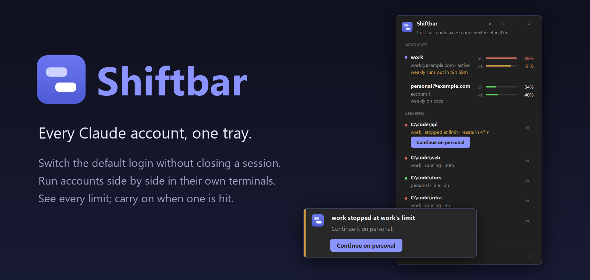
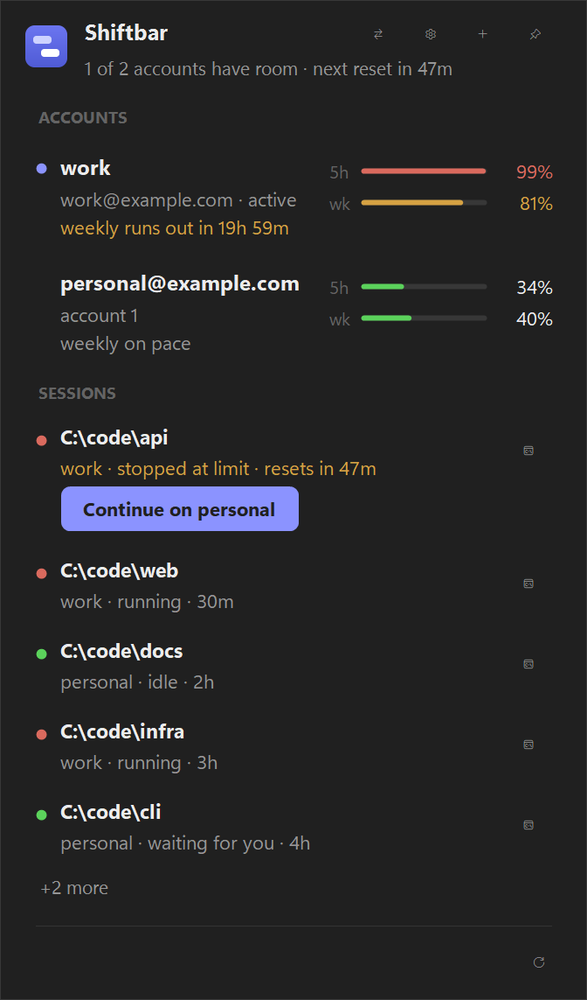
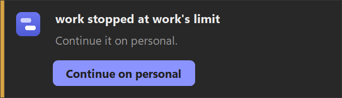

  

  
  
  
  
  

  <b>Stop rationing your week.</b> When one Claude account hits its limit, the others sit idle. 
  Shiftbar keeps all your Claude Code accounts in the tray and moves you to the one with room, without closing a session.

  
  &nbsp;&nbsp;
  

## Why Shiftbar

- **🔀 Switch without breaking anything.** One click, or auto-switch near a limit; an account you pick yourself stays until it runs out. A switch never closes or restarts a Claude Code window, and on Windows Remote Control reconnects in idle windows afterwards.
- **🪟 Accounts side by side.** Open a terminal as any account while the others keep running. Pin a project folder to an account.
- **📊 Every limit in one place.** 5-hour and weekly meters for each account, a pace forecast, the next reset, and one `/stats` across all accounts.
- **⏭️ Carry on at a limit.** On Windows, when a session stops at its limit, one click continues it on the account with room, conversation intact.

## How it compares

|  | Shiftbar | [claude-swap](https://github.com/realiti4/claude-swap) | [Claude Usage Tracker](https://github.com/hamed-elfayome/Claude-Usage-Tracker) |
|---|:---:|:---:|:---:|
| Usage meters for several accounts | ✅ | ✅ | ✅ |
| Switches Claude logins | ✅ | ✅ | ✅ |
| Accounts side by side | ✅ | ✅ | ✅ |
| Auto-switch | ✅ near a limit | ✅ near a limit | at the limit |
| Native Windows | ✅ tray | CLI | – |

Shiftbar is built on claude-swap's credential and usage engine. Everything stays local: no proxy, no cloud.

## Quick start

**Windows 11:** needs [Claude Code](https://docs.anthropic.com/en/docs/claude-code).

1. **Download** `shiftbar-win-x64.zip` from the [latest release](https://github.com/trexchery/shiftbar/releases/latest), extract it, and run `shiftbar.exe`.
2. **Add your accounts.** Open the tray icon and use **+** to sign in to each one through the official Claude Code login.
3. **Work.** Switch from the flyout, or use **Open terminal** to run Claude Code as a specific account.

**macOS (Apple Silicon):** see [docs/macos.md](docs/macos.md).

**Claude in Chrome (optional):** the extension only connects when it is signed in to the same claude.ai account as Claude Code. Shiftbar can open the right browser profile on every switch:

1. **One profile per account.** In Chrome, Chrome Canary, Edge or Brave, make a profile for each Claude account and name it after that account's email. A profile signed in to Google with the same email also matches.
2. **Sign in.** In each profile, sign in to claude.ai and to the Claude extension with that account.
3. **Turn it on.** In Shiftbar's settings, turn on **Open each account's browser profile** and pick the browser. To use a profile with another name, pick it under **Browser profile** in the account's **More** menu (on macOS, under **Account tools**).

## What's inside

<table>
<tr>
<td width="33%" valign="top">

**Accounts**

- 5-hour and weekly meters
- weekly pace and next reset
- one-click switch to the best account
- one `/stats` for all accounts

</td>
<td width="33%" valign="top">

**Sessions**

- terminal per account
- folder pins
- live Sessions panel (Windows)
- Remote Control reconnect (Windows)
- browser profile follows the account (opt-in)

</td>
<td width="33%" valign="top">

**Limits**

- auto-switch (opt-in)
- Continue on the best account (Windows)
- quota alerts (opt-in)
- Auto-Prime (opt-in)

</td>
</tr>
</table>

> [!IMPORTANT]
> **Read Anthropic's terms.** The [Consumer Terms](https://www.anthropic.com/legal/consumer-terms) and [Usage Policy](https://www.anthropic.com/legal/aup) restrict sharing credentials and automated access, and plan limits assume ordinary individual use. Auto-switch and Auto-Prime are off by default; turning them on is your call. Shiftbar is not affiliated with Anthropic.

<b>Good to know</b>

- **Local only.** No telemetry, no cloud sync, no proxy. Logins stay on your machine: DPAPI on Windows, the Keychain on macOS.
- **Never interrupts.** Shiftbar doesn't close or restart a Claude Code window you can see. With auto-switch on, a session whose terminal has already died is reopened with `--resume` (Windows). The only thing it ever types is `/remote-control`, into an idle window with an empty prompt, while you're away from the keyboard.
- **Windows only, for now:** the Sessions panel, Continue on, reopening dead sessions with `--resume`, and Remote Control reconnect. macOS has the rest in its menu bar; [docs/macos.md](docs/macos.md) lists the gaps.
- **Browser follows the account (opt-in).** Chromium browsers only: Chrome, Chrome Canary, Edge and Brave. On every switch, including one made with `cswap`, Shiftbar opens the new account's profile unless it is already open. A running Claude session stays tied to the profile it started with, so the old account's windows close only once every session that started before the switch has ended. Turn off **Close the old account's windows** to keep them. The current account's profile is never closed. On macOS, closing windows needs Accessibility permission (System Settings → Privacy & Security → Accessibility); without it they stay open.
- **One `/stats`.** Usage on your other accounts is added to the "All time" view of your normal `claude` once each UTC day ends. Preview with `cswap stats-sync --dry-run`.
- **Unsigned releases**, so SmartScreen may warn. A `.sha256` checksum ships with every download. See [SECURITY.md](SECURITY.md).
- **Upgrading from Patch Goblins:** quit the old tray and run `shiftbar.exe` once. Settings, logins and autostart carry over.
- **The engine is `cswap`.** It ships in `engine\` and is documented in [docs/claude-swap.md](docs/claude-swap.md).
- **Build from source:** `pwsh dock\build.ps1` (needs [uv](https://docs.astral.sh/uv/) and the .NET 8 SDK). On macOS: `bash macos/install.sh`.

Built on <a href="https://github.com/realiti4/claude-swap">claude-swap</a> by Onur Cetinkol · <a href="LICENSE">MIT</a>

